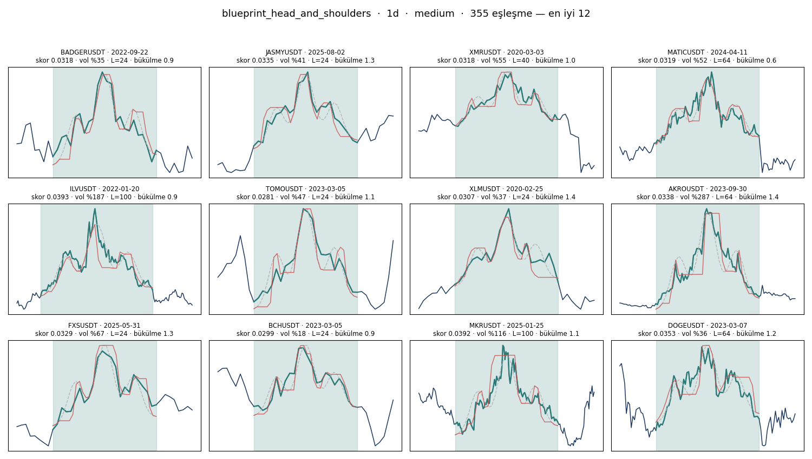

<div align="center">

# GraphFlow

**A visual search engine for chart patterns — draw a shape, find where the market drew it, and see honestly what happened next.**

[English](README.md) · [Türkçe](README.tr.md)

[](https://github.com/7mertyavuz/GraphFlow/actions/workflows/ci.yml)
[](LICENSE)

</div>

---



<sub>Twelve head-and-shoulders patterns GraphFlow found in real Binance daily data. Dark line: price. Red: the canonical shape warped onto the match. Shaded: the matched window.</sub>

---

## What it does

You sketch a pattern with your mouse — pick one of 14 classic formations, or point at a piece of a real chart (*"what do BTCUSDT's last 64 bars look like?"*) — and GraphFlow searches **11.6 million** historical windows of real crypto price data for places where the market drew the same shape. In historical mode it then reports what happened *after* those formations, next to a baseline of what the market was doing anyway.

| Mode | Question it answers |
|---|---|
| **Radar** (live) | *Which coins are forming this shape right now?* |
| **Backtest** (historical) | *When this shape appeared in the past, what happened next — and was that different from chance?* |

Both modes run on the same engine; Radar is the historical search anchored to the latest closed bar.

## What makes it different

Most open-source pattern tools are rule-based detectors that tell you a pattern *exists*. Almost none tell you whether it *matters*. GraphFlow is built around that second question:

- **You draw the query.** Freehand sketches are normalized server-side (scale and level invariant), and the engine tells you how it read your drawing: *"3 prominent peaks · the middle one highest · the others at similar levels"*.
- **Every statistic has a baseline.** Outcomes are compared against a time-matched shadow sample of random windows from the same months — not against zero.
- **Honest uncertainty.** Month-block bootstrap confidence intervals, Bonferroni correction across all 56 tests, and results reported for *every* template, not just the ones that look good.
- **Survivorship-free data.** The universe includes delisted pairs from the Binance archive. Stablecoins, leveraged tokens and *twins* (wrapped tokens such as WBTC that trade as the same price series as their original) are removed by measured rules, so one price move is never counted twice.
- **Measured, not assumed.** Every filter in the engine was A/B-tested against injected ground truth before it was switched on — and several were rejected.

## The honest finding

After replicating every test on two timeframes (1d and 4h) and against a baseline matched on prior returns:

> **No chart pattern shape carries information beyond short-term momentum reversal.**

The one effect that replicates — prices tend to fall after a rising wedge — disappears once the baseline is matched on how much the price had already risen. The pattern is a proxy for momentum, not an independent signal. GraphFlow reports this rather than hiding it; that is the point of the tool.

## How it works

```
 drawing / template
        │   log price → resample to 32 points → z-score
        ▼
 Stage 1   cosine similarity over all windows (one matrix product)   11.6M → 12,500
 Pre-NMS   1-D IoU 0.70 — collapse overlapping windows
 Stage 2   hybrid DTW (derivative + raw, Sakoe–Chiba band)           → 2,500 scored
 Threshold query-relative null percentile + absolute sanity cap
 Filters   structural signature (peaks/troughs)  ┐ each applied only when the
           trend-line envelope (slopes)          ┘ query's reading is stable
 Post-NMS  1-D IoU 0.50, max 3 per symbol → independent events
        │
        ▼
 results grid  +  "what happened next": triple-barrier outcomes vs. shadow baseline
```

A warm search over 11.6 million windows takes about **300 ms** on a laptop. There is no Kafka, no Rust, no time-series database — the bottleneck was never the language, it was the data layout.

## Quick start

**Requirements:** Python 3.11+ (3.12 tested), Node.js 20+, ~3 GB disk for data.

```bash
git clone https://github.com/7mertyavuz/GraphFlow.git
cd GraphFlow

# 1. Python environment
python -m venv .venv
source .venv/bin/activate            # Windows: .venv\Scripts\activate
pip install -r requirements.txt

# 2. Data — free, no API key (Binance public archive, delisted pairs included)
python -m engine.ingest.download --timeframes 1d 4h
python -m tools.backfill --timeframe 4h     # complete 4h to the full universe

# 3. Build the search matrices (~2 GB of memory-mapped vectors)
python -m engine.matrix.build

# 4. Run
uvicorn engine.api.main:app --port 8000     # API
cd frontend && npm install && npm run dev   # UI → http://localhost:3000
```

To try it quickly on a subset, add `--limit-symbols 50` to the download step. The data directory can live anywhere via `GRAPHFLOW_DATA_DIR`.

## Using it

The interface is available in **English and Turkish** — switch with the **EN / TR** toggle in the header (it follows your browser language on first visit).

1. **Draw** a shape on the canvas — left to right; going back overwrites — or open **Library** and pick a formation, or open **Chart** and pick a symbol, a segment length and (in Backtest) an end date. A chart segment is cut and normalized on the server exactly like the search windows; windows overlapping it are excluded — in Backtest across *all* symbols, since the same market move in another coin is not a historical analog.
2. Choose the **timeframe** (4 hours / 1 day) and **tolerance** (Strict · Medium · Flexible). Tolerance is a percentile of the query's own null distribution, not a fake "% similarity".
3. Read **how the engine understood your drawing** above the results. If the reading is marked unstable, the engine tells you it did not narrow results by it — redraw more clearly if it misread you.
4. In **Backtest**, the **What happened next?** panel shows expectancy in R (the headline metric), win rate next to its theoretical null, the shadow baseline and the edge with a confidence interval. Small samples are flagged instead of shown as headline numbers. Below them, a **forward path fan** shows what price did after the matches (median, 25–75% and 10–90% bands, in ATR units, up to the time barrier) drawn on the same axes as the shadow sample's fan — a fan without a control group would credit the pattern with whatever the market was doing anyway. Each match card also shows **that event's own outcome** for the selected configuration and direction (target / stop / time-out, R, exit bar) — or why it was *not counted* (overlapping an earlier event's forward window, the transaction-cost floor, right after listing). The headline number is exactly the mean of the counted cards.
5. The **Findings** page lists every test, the stage where each finding was eliminated, and which engine version produced the numbers.

## Verifying the engine yourself

GraphFlow ships the tools that were used to validate it:

```bash
pytest -q                                              # 300+ tests
python -m tools.formation_audit --cross                # audit the auditor (no data needed)
python -m tools.gt_benchmark --family all              # ground truth: injected patterns
python -m tools.gt_benchmark --family all --real       # …on a real-market background
python -m tools.gt_benchmark --family all --freehand 6 # …with simulated hand drawings
python -m tools.verify_stage1 --timeframe 1d           # matrix vs. brute force
python -m tools.ci_calibration                         # does a 95% CI cover 95%?
python -m tools.run_outcomes --timeframe 1d            # regenerate the statistics
python -m tools.f46_proxy_test                         # shape or momentum proxy?
```

Measurement files record which engine produced them (a behavioral fingerprint). If you change the engine and do not re-run the measurements, the Findings page says so.

## Project layout

```
engine/
  ingest/      Binance downloader (REST + archive), resumable, rate-limited
  normalize/   log → resample → z-score, ATR, amplitude
  matrix/      memory-mapped window vectors, liquidity filter
  search/      cosine stage, DTW/DDTW, NMS, structural & envelope filters
  outcome/     triple-barrier, shadow baseline, block bootstrap
  api/         FastAPI: search, stats, charts, findings, freshness
  templates/   14 canonical formations as 32-point vectors
frontend/      Next.js 16 · Tailwind v4 · TanStack Query · Lightweight Charts
tools/         validation and measurement tools (see above)
tests/         pytest suite, including real-corpus sentinels
notebooks/     original validation notebooks and figures
docs/          design decisions and measurement reports
```

## Documentation

The design record and the measurement reports are written in **Turkish**; see [docs/README.md](docs/README.md) for an English index.

- [Design decisions](docs/00-tasarim-kararlari.md) — 21 architectural decisions, each with the alternatives that were rejected and why
- [Architecture](docs/01-mimari.md) — data layer, algorithms, API, performance budget
- Measurement reports — validation, outcome statistics, proxy test, timeframe replication, formation audit

## Contributing

Contributions are welcome. GraphFlow has a few non-negotiable correctness rules (no lookahead, independent samples, baselines for every rate, replication across timeframes) — please read [CONTRIBUTING.md](CONTRIBUTING.md) first.

## Tech stack

**Engine:** Python · NumPy · pandas · PyArrow · FastAPI
**Data:** Binance public klines · Parquet · `.npy` memory-mapped matrices
**Frontend:** Next.js 16 · React 19 · Tailwind CSS v4 · TanStack Query · TradingView Lightweight Charts · plain HTML5 Canvas

## License

[MIT](LICENSE)

## Disclaimer

GraphFlow is a **research tool**, not investment advice. Every statistic it produces describes past price behavior and is not an indication of future performance.
