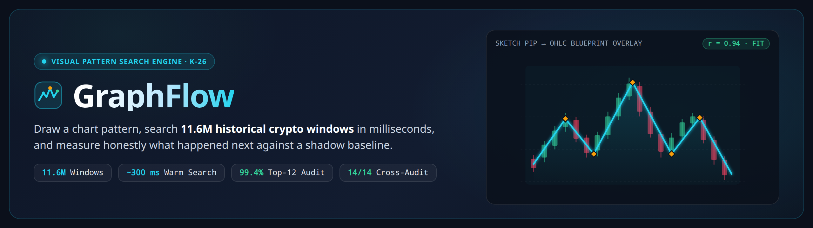
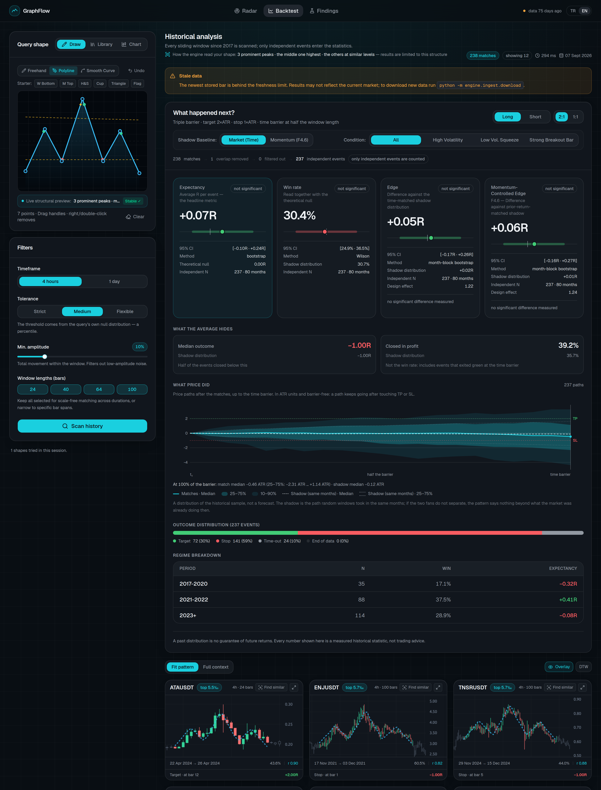
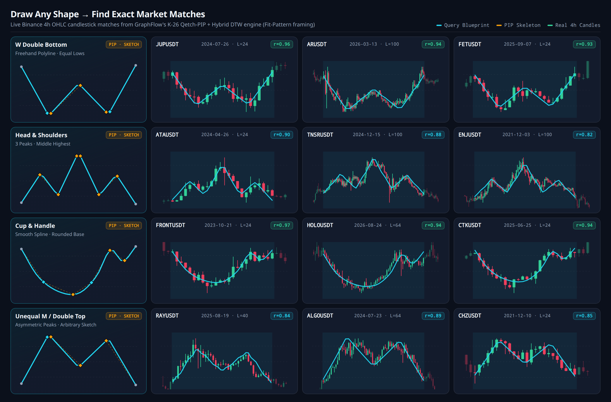
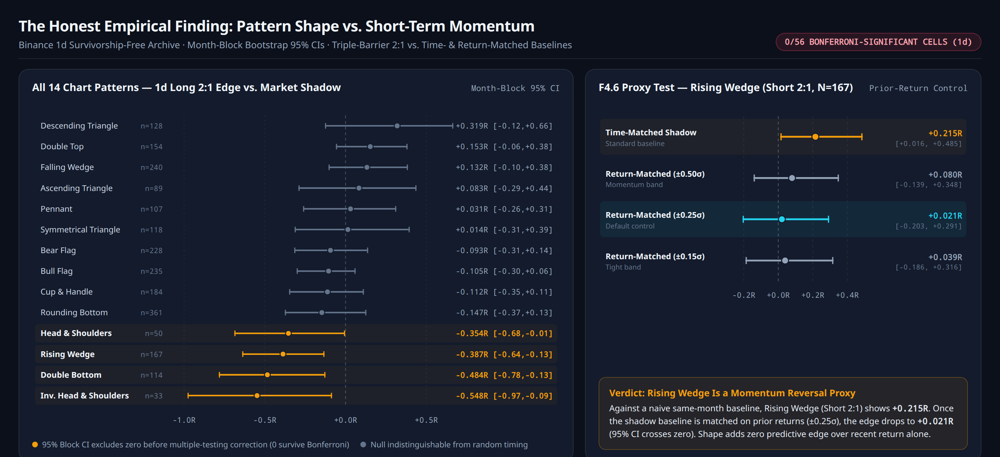
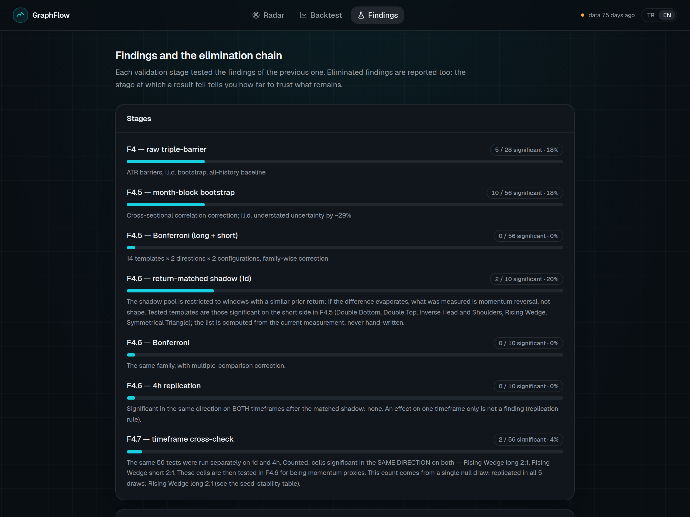
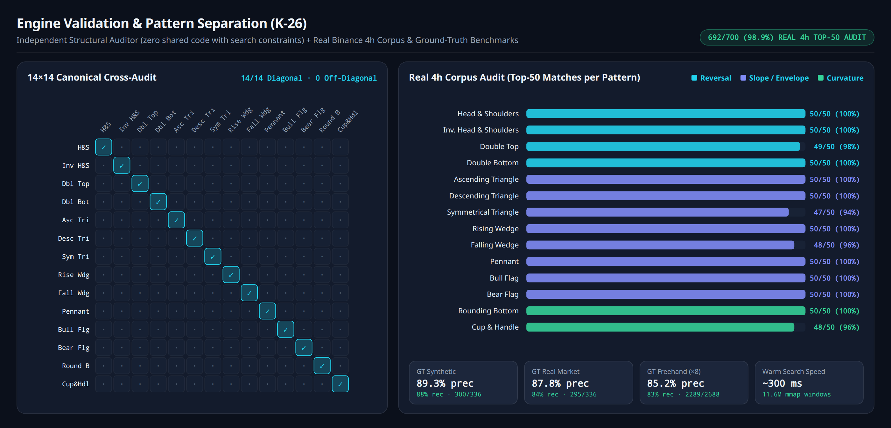

<div align="center">



**A visual search engine for chart patterns — draw a shape, find where the market drew it across 11.6M windows, and measure honestly what happened next.**

[English](README.md) · [Türkçe](README.tr.md)

[](https://github.com/7mertyavuz/GraphFlow/actions/workflows/ci.yml)
[](pyproject.toml)
[](frontend/package.json)
[](engine/api/main.py)
[](tests/)
[](LICENSE)

[Features](#why-graphflow) · [Live UI](#live-web-interface) · [Sketch → Match](#sketch-to-market-matches) · [Honest Finding](#the-honest-finding) · [How It Works](#how-it-works) · [Benchmarks](#benchmarks) · [Quick Start](#quick-start) · [Docs](#documentation)

</div>

---

## Live Web Interface



<sub>Live Next.js 16 + Lightweight Charts v5 workspace: interactive PIP-aware Sketch Studio (left), month-block bootstrap &amp; momentum-controlled Outcome Panel + Forward Path Fan (top right), and Fit-Pattern OHLC candlestick cards with cyan Blueprint overlays (bottom right).</sub>

---

## Why GraphFlow

Most open-source chart pattern tools are rigid rule-based detectors that only claim a pattern *exists*. GraphFlow is built around visual geometry *and* empirical accountability:

<table>
  <tr>
    <td width="50%">
      <strong>Interactive Sketch Studio 3.0</strong><br />
      Draw in <em>Freehand</em>, <em>Polyline</em>, or <em>Smooth Curve (Catmull-Rom)</em> mode, or load 6 editable starter presets (<code>W</code>, <code>M</code>, <code>H&amp;S</code>, <code>Cup</code>, <code>Triangle</code>, <code>Flag</code>) with live extremum, PIP diamond, trendline, and Legendre parabolic bowl previews.
    </td>
    <td width="50%">
      <strong>11.6M Windows in ~300 ms</strong><br />
      Zero Kafka, zero Rust, zero external time-series DB. Pure NumPy memory-mapped (<code>.npy</code>) search over Binance's full survivorship-free historical archive (delisted pairs included, twins &amp; pegged assets filtered out).
    </td>
  </tr>
  <tr>
    <td width="50%">
      <strong>Fit-Pattern Candlestick Cards</strong><br />
      Matches zoom directly into the pattern with isolated Y-axis scaling, OHLC wick-cleanliness ranking (K-26), optional dynamic DTW warp lines, and one-click <em>Find similar</em> pivot search.
    </td>
    <td width="50%">
      <strong>Honest Empirical Statistics</strong><br />
      Every triple-barrier outcome (2:1 and 1:1 ATR targets) is measured against time-matched and prior-return-matched shadow baselines with month-block bootstrap 95% CIs and Bonferroni correction across all 56 tests.
    </td>
  </tr>
</table>

| Mode | Question it answers |
|---|---|
| **Backtest** *(historical — 11.6M windows)* | *When the market drew this shape in history, what happened next — and did it beat chance or mere momentum?* |
| **Radar** *(live — latest closed bars)* | *Which coins are forming this exact shape right now, with one-click handoff to the 11.6M archive if live matches are scarce?* |

---

## Sketch to Market Matches



- **Server-side shape understanding:** Drawings are normalized (log-space, 256-pt uniform-x Gaussian smoothing, 32-pt z-score) so scale and price level never matter, and the UI reports how the engine interpreted your curve (e.g., *"3 prominent peaks · the middle one highest · others at similar levels"*).
- **Universal Qetch-PIP alignment (`K-26`):** Even completely arbitrary hand-drawn shapes outside classical template gates are ranked via mirror- and flip-equivariant perceptual skeleton (`pip_skeleton`) + monotonic leg matching + curvature constraints (`K-24`..`K-26`).
- **OHLC-aware card framing:** Context bars before/after the match never squash the formation on the Y-axis (`Fit pattern`), and extreme-wick candles are demoted in top-page ranking (`WICK_RERANK`) without altering the statistical outcome pool (`K-09`).

---

## The Honest Finding

> **No chart pattern shape carries predictive edge beyond short-term momentum reversal.**



- Across **14 patterns × 2 directions × 2 R-configs (56 tests)** replicated on both `1d` and `4h` Binance archives, **0 / 56** cells survive Bonferroni correction *and* prior-return baseline control.
- **The Rising Wedge illusion (`F4.6`):** Against a standard time-matched shadow baseline, Rising Wedge (Short 2:1, `N=167`) shows an apparent `+0.215R` edge (`95% CI [+0.016, +0.485]`). Once random shadow windows are matched on prior return (`±0.25σ`), the edge collapses to **`+0.021R`** (`[-0.203, +0.291]`).
- **Built-in skepticism:** GraphFlow reports null sensitivity across 5 independent 20,000-window draws (`K-25`) and flags seed-fragile cells rather than cherry-picking winners.

<details>
<summary>Preview the interactive <strong>Findings &amp; Elimination Chain</strong> page (<code>/bulgular</code>)</summary>

<br />



</details>

---

## How It Works

```mermaid
flowchart LR
    Q["Query Input<br/>(Sketch · Preset · Chart Slice)"] --> NORM["Normalize<br/>(256-pt Gaussian · Log · 32-pt z-score)"]
    NORM --> S1["Stage 1 Cosine<br/>(11.6M → 12.5k mmap dot product)"]
    S1 --> PNMS["Pre-NMS<br/>(1D IoU 0.70 dedup)"]
    PNMS --> S2["Stage 2 Hybrid DTW<br/>(Derivative + Raw · Sakoe-Chiba)"]
    S2 --> THR["Null Threshold<br/>(p01 tail · 20k null draws)"]
    THR --> FILT["Stability Gates<br/>(Peaks · Trendlines · Two-Regime Pole)"]
    FILT --> RERANK["K-26 Rerank<br/>(Qetch-PIP Skeleton · Curvature · OHLC Wick)"]
    RERANK --> OUT["Post-NMS + Triple-Barrier<br/>(Fit-Pattern Cards · Block CI · Baselines)"]
```



A warm query across **11.6 million** historical windows runs in **~300 ms** on a standard laptop. Every filter in the cascade was A/B tested against injected and real-market ground truth before being turned on — and several heuristics were rejected and documented in [the design decisions record](docs/00-tasarim-kararlari.md).

---

## Benchmarks



| Benchmark | K-26 Result |
|---|---|
| `formation_audit --cross` *(14×14 independent cross-audit)* | **14 / 14 diagonal · 0 off-diagonal accepts** |
| `formation_audit --top 12` *(real 4h corpus, all 14 formations)* | **167 / 168 (99.4%)** |
| `formation_audit --top 50` *(real 4h corpus, all 14 formations)* | **692 / 700 (98.9%)** |
| `gt_benchmark --family all` *(synthetic injected ground truth)* | **89.3% precision · 88% avg recall** *(300 / 336)* |
| `gt_benchmark --family all --real` *(real-market background)* | **87.8% precision · 84% avg recall** *(295 / 336)* |
| `gt_benchmark --family all --freehand 8` *(2,688 jittered hand drawings)* | **85.2% precision · 83% avg recall** *(2,289 / 2,688)* |

<details>
<summary>Run the verification &amp; benchmark suite yourself</summary>

```bash
.venv/bin/pytest -q                                    # Full unit & invariance suite
python -m tools.formation_audit --cross                # Audit the structural auditor (no data required)
python -m tools.gt_benchmark --family all              # Injected ground truth benchmark
python -m tools.gt_benchmark --family all --real       # Real-market background benchmark
python -m tools.gt_benchmark --family all --freehand 8 # Simulated noisy hand drawings
python -m tools.verify_stage1 --timeframe 1d           # Memory-mapped Stage 1 vs brute force
python -m tools.ci_calibration                         # Empirical 95% block-CI coverage check
python -m tools.run_outcomes --timeframe 1d            # Regenerate outcome tables (updates engine fingerprint)
python -m tools.f46_proxy_test                         # Pattern shape vs prior-return proxy test
```

Measurement JSONs record an engine behavioral fingerprint (`engine/fingerprint.py`); if you modify search parameters without re-running measurements, the **Findings** page automatically flags tables as stale.

</details>

---

## Quick Start

**Requirements:** Python 3.11+ *(3.12 tested)*, Node.js 20+ *(24 tested)*, ~25 MB disk for the demo corpus *(or ~3 GB for the full 11.6M-window archive)*.

### Option A — 10-Second Interactive Demo (Synthetic Corpus)

```bash
git clone https://github.com/7mertyavuz/GraphFlow.git
cd GraphFlow

make setup       # creates .venv, installs Python & Node dependencies
make dev-demo    # generates 24-symbol 1d+4h demo corpus (~5s) & launches API (:8000) + UI (:3000)
```

Then open **`http://localhost:3000/backtest`**. *(On Windows without `make`: run `python -m tools.generate_demo_corpus --out data/demo`, then start `GRAPHFLOW_DATA_DIR=data/demo uvicorn engine.api.main:app --port 8000` and `cd frontend && npm run dev`.)*

### Option B — One-Command Docker Stack

```bash
docker compose up --build   # UI → http://localhost:3000 · API → http://localhost:8000
```

### Option C — Full Binance Historical Corpus (11.6M Windows)

```bash
make download        # free Binance public archive (no API key; includes delisted pairs)
make build-matrix    # builds ~2 GB of memory-mapped .npy search vectors
make dev             # launches FastAPI (:8000) + Next.js (:3000) together
```

<details>
<summary>Quick subset &amp; custom data directory options</summary>

- **Test on a real 50-symbol subset:** `python -m engine.ingest.download --timeframes 1d 4h --limit-symbols 50 && make build-matrix`
- **Relocate storage anywhere:** set `GRAPHFLOW_DATA_DIR=/path/to/data`
- **Regenerate README graphics:** `make assets` (requires `google-chrome-stable`)

</details>

---

## Using GraphFlow

1. **Query** — Switch **EN / TR** anytime in the header. Draw in **Freehand**, **Polyline**, or **Smooth Curve**, click a starter preset (`W`, `M`, `H&S`, `Cup`, `Triangle`, `Flag`) and drag/right-click handles, pick from the 14-template **Library**, or slice any real coin window in **Chart**.
2. **Search & Frame** — Choose timeframe (`4h` / `1d`), window lengths (`24 · 40 · 64 · 100`), min amplitude, and continuous `p01`-anchored tolerance (`Strict · Medium · Flexible`). Switch between **Fit pattern** and **Full context**, toggle **Overlay** or **DTW** warp curves, or click any card to inspect full Triple-Barrier overlays (`C₀`, `TP`, `SL`, exit bar).
3. **Evaluate Honestly** — In **Backtest**, compare **Expectancy (R)** and **Edge** across **Market (Time)** vs **Momentum (F4.6)** baselines, filter causally by entry regime (`High Volatility`, `Low Vol. Squeeze`, `Strong Breakout Bar`), and verify seed stability on **Findings**.

---

## Project Layout & REST API

<details>
<summary>Repository layout</summary>

```text
engine/
  ingest/        Resumable Binance downloader (archive + REST), continuity checks
  normalize/     Log price, 256-pt Gaussian smoothing, 32-pt z-score, ATR, amplitude
  matrix/        Memory-mapped .npy window vectors, liquidity & twin-asset filters
  search/        Cosine Stage 1, Hybrid DTW/DDTW Stage 2, 1D NMS, K-20..K-26 perceptual constraints
  outcome/       Triple-barrier evaluator, time & return-matched shadow pools, block bootstrap
  api/           FastAPI routes: /api/search, /api/chart, /api/templates, /api/findings, /api/health
  templates/     14 canonical pattern definitions (JSON)
frontend/        Next.js 16 · React 19 · Tailwind v4 · TanStack Query v5 · Lightweight Charts v5
tools/           Audit, benchmark, calibration, demo generator & README asset tools
tests/           Pytest suite covering search invariants, outcomes, API contracts & real-corpus sentinels
notebooks/       Original exploratory validation notebooks and figures
docs/
  assets/        Reproducible README showcase charts & UI screenshots (tools/generate_readme_assets.py)
  *.md           Design decisions (K-01 … K-26), architecture, and measurement reports
```

</details>

<details>
<summary>Key REST API endpoints (auto-synced to <code>frontend/openapi.json</code>)</summary>

| Method & Path | Description |
|---|---|
| `POST /api/search` | Search by freehand `[x, y]` points, `template_id`, or historical chart window |
| `GET /api/search/{search_id}` | Paginated matches cached per query session |
| `GET /api/search/{search_id}/stats` | Triple-barrier outcomes, shadow baseline edge, forward fan & causal condition slicing |
| `GET /api/chart/{symbol}` | Context OHLCV candles, highlight span & server-mapped Blueprint / Warped overlays |
| `GET /api/templates` | 14 canonical formations with descriptions and icons |
| `GET /api/symbols` | Available symbols for the requested timeframe |
| `GET /api/findings` | 56-cell elimination chain, 5-seed null stability table & engine fingerprint status |
| `GET /api/health` | Data availability, store freshness & server readiness |

</details>

---

## Documentation

The full engineering decision log and measurement reports are indexed in **[docs/README.md](docs/README.md)** *(reports are written in Turkish with English summaries)*:

- **[Design Decisions (`docs/00-tasarim-kararlari.md`)](docs/00-tasarim-kararlari.md)** — 26 architectural decisions (`K-01 … K-26`), alternatives rejected, and empirical justification
- **[Architecture (`docs/01-mimari.md`)](docs/01-mimari.md)** — Data layout, normalization math, cascade stages, API contracts, and latency budgets
- **Measurement Reports (`docs/03 … docs/13`)** — Threshold calibration, survivorship & twin filters, month-block bootstrap calibration, F4.6 momentum proxy proof, timeframe cross-check, and null sensitivity

---

## Contributing & License

Contributions are welcome — please read **[CONTRIBUTING.md](CONTRIBUTING.md)** first for GraphFlow's non-negotiable scientific invariants (no lookahead bias, independent forward events, baseline-paired rates, and cross-timeframe replication).

**Tech Stack:** Python · NumPy · pandas · PyArrow · FastAPI · Next.js 16 · React 19 · Tailwind CSS v4 · TanStack Query v5 · TradingView Lightweight Charts v5 · HTML5 Canvas

Licensed under **[MIT](LICENSE)**. If you reference GraphFlow in research, see [CITATION.cff](CITATION.cff).

> **Disclaimer:** GraphFlow is a **quantitative research tool**, not financial or investment advice. All outputs measure past historical price behavior and make no guarantee about future returns.
