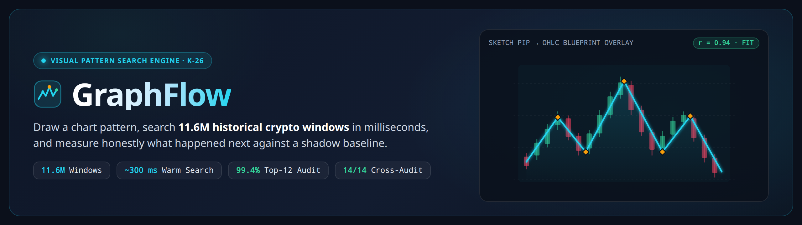
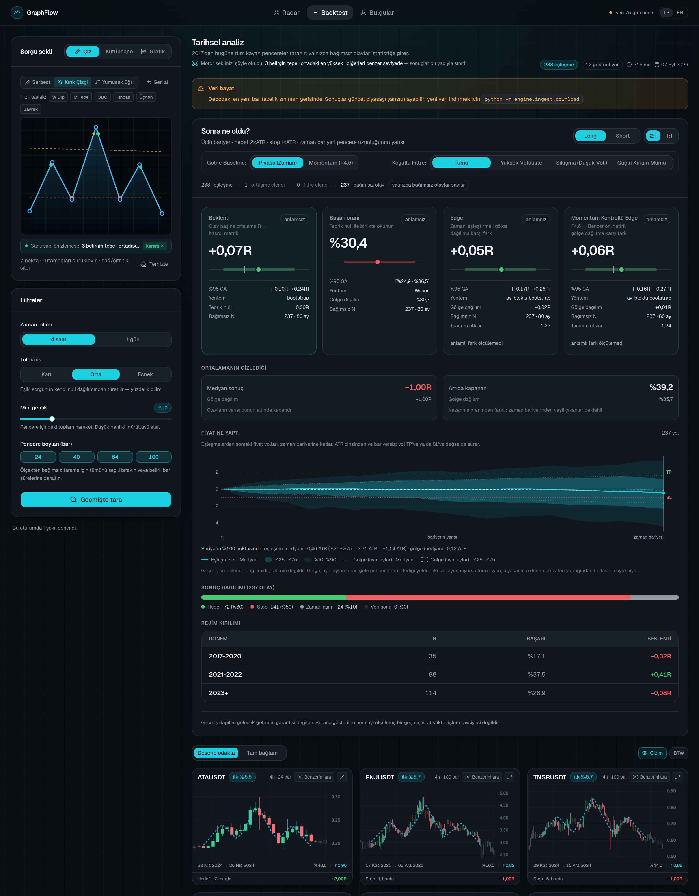
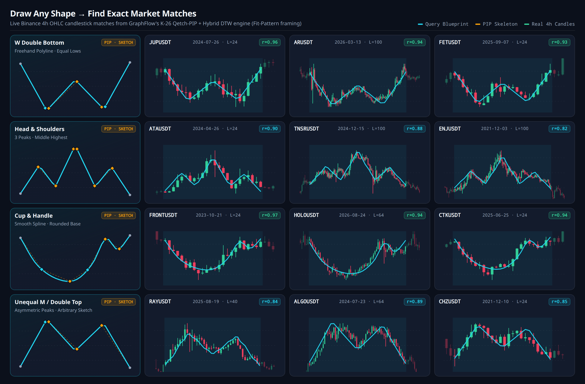
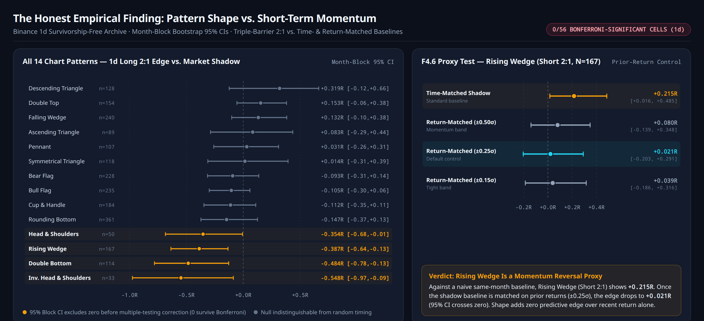
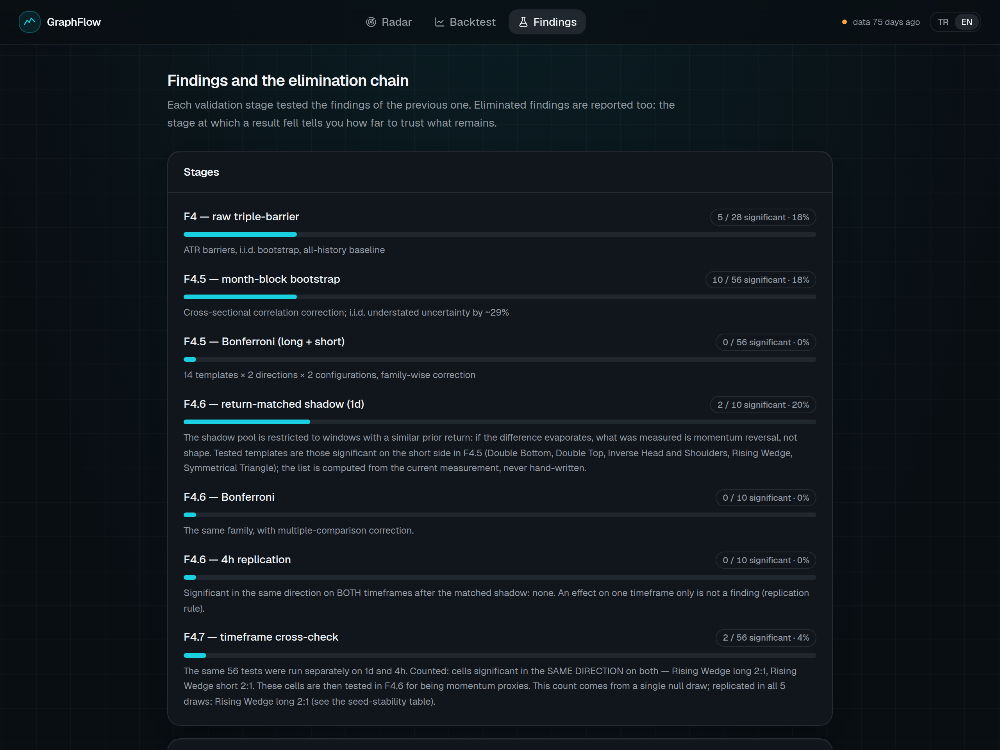
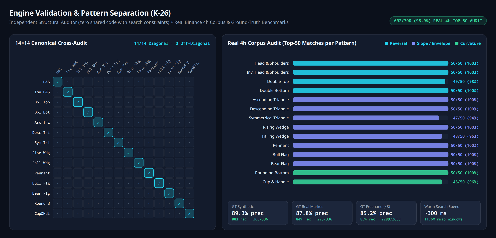

<div align="center">



**Grafik formasyonları için görsel arama motoru — bir şekil çiz, piyasanın onu 11,6M pencerede nerede çizdiğini bul ve sonra ne olduğunu dürüstçe ölç.**

[English](README.md) · [Türkçe](README.tr.md)

[](https://github.com/7mertyavuz/GraphFlow/actions/workflows/ci.yml)
[](pyproject.toml)
[](frontend/package.json)
[](engine/api/main.py)
[](tests/)
[](LICENSE)

[Özellikler](#neden-graphflow) · [Canlı Arayüz](#canlı-web-arayüzü) · [Çizim → Eşleşme](#çizimden-piyasa-eşleşmelerine) · [Dürüst Bulgu](#dürüst-bulgu) · [Nasıl Çalışır](#nasıl-çalışır) · [Ölçümler](#ölçümler) · [Hızlı Başlangıç](#hızlı-başlangıç) · [Belgeler](#belgeler)

</div>

---

## Canlı Web Arayüzü



<sub>Canlı Next.js 16 + Lightweight Charts v5 arayüzü: PIP işaretçili etkileşimli Çizim Stüdyosu (sol), ay-bloklu bootstrap ve momentum kontrollü Sonuç Paneli + İleri Yol Fanı (sağ üst) ve camgöbeği Blueprint bindirmeli Desene Odaklı OHLC mum kartları (sağ alt).</sub>

---

## Neden GraphFlow

Açık kaynaktaki formasyon araçlarının çoğu yalnızca bir desenin *var olduğunu* iddia eden katı kural motorlarıdır. GraphFlow hem görsel şekli hem de ampirik hesap verebilirliği bir arada sunar:

<table>
  <tr>
    <td width="50%">
      <strong>Etkileşimli Çizim Stüdyosu 3.0</strong><br />
      <em>Serbest</em>, <em>Kırık Çizgi</em> veya <em>Yumuşak Eğri (Catmull-Rom)</em> modlarında çizin ya da düzenlenebilir 6 hazır taslaktan (<code>W Dip</code>, <code>M Tepe</code>, <code>OBO</code>, <code>Fincan</code>, <code>Üçgen</code>, <code>Bayrak</code>) birini sürükleyip şekillendirin; tepe/dip, PIP dirsekleri, trend çizgileri ve Legendre parabolik çanak önizlemesini anlık görün.
    </td>
    <td width="50%">
      <strong>~300 ms içinde 11,6M Pencere</strong><br />
      Kafka yok, Rust yok, ayrı zaman serisi veritabanı yok. Tam Binance tarihsel arşivinde (delist pariteler dahil; stablecoin, kaldıraçlı ve ikiz tokenlar elenmiş) saf NumPy memory-mapped (<code>.npy</code>) arama.
    </td>
  </tr>
  <tr>
    <td width="50%">
      <strong>Desene Odaklı Mum Kartları</strong><br />
      Kartlar yalnızca eşleşen formasyonun Y eksenine odaklanır (<code>Desene odakla</code>), aşırı fitilli mumları geri sıraya alır (K-26), isteğe bağlı DTW bükme çizgilerini gösterir ve tek tıkla <em>Benzerini ara</em> sunar.
    </td>
    <td width="50%">
      <strong>Dürüst Ampirik İstatistikler</strong><br />
      Her üçlü bariyer sonucu (2:1 ve 1:1 ATR hedefleri), zaman-eşleştirmeli ve ön-getiri eşleştirmeli gölge baseline'lara karşı ay-bloklu bootstrap %95 GA ve 56 test üzerinde Bonferroni düzeltmesiyle ölçülür.
    </td>
  </tr>
</table>

| Mod | Yanıtladığı soru |
|---|---|
| **Backtest** *(tarihsel — 11,6M pencere)* | *Piyasa geçmişte bu şekli çizdiğinde ardından ne oldu — ve bu sonuç şansı ya da salt momentumu yenebildi mi?* |
| **Radar** *(canlı — son kapanmış barlar)* | *Şu anda hangi coin'ler bu şekli oluşturuyor — canlıda az örnek varsa tek tıkla 11,6M tarihsel arşive aktarım!* |

---

## Çizimden Piyasa Eşleşmelerine



- **Sunucu taraflı şekil anlama:** Çizimler log uzayında 256 noktalı uniform-x Gauss yumuşatma ve 32 noktalı z-score ile normalize edilir; ölçek ve fiyat seviyesinden bağımsız arama yapılır ve motorun çiziminizi nasıl okuduğu arayüzde açıkça yazılır (*"3 belirgin tepe · ortadaki en yüksek · diğerleri benzer seviyede"*).
- **Evrensel Qetch-PIP hizalama (`K-26`):** Klasik şablon geçitlerinin dışında kalan tamamen keyfi el çizimleri bile ayna ve ters-simetrik algısal iskelet (`pip_skeleton`), monotonik bacak uyumu ve eğrisellik cezaları (`K-24`..`K-26`) ile sıraya konur.
- **OHLC farkındalıklı kart çerçeveleme:** Formasyon öncesi ve sonrası bağlam barları desen yüksekliğini ezmez (`Desene odakla`), aşırı iğneli mumlar istatistik havuzunu bozmadan (`K-09`) ilk sayfalarda geriye çekilir (`WICK_RERANK`).

---

## Dürüst Bulgu

> **Hiçbir grafik formasyonunun şekli, kısa vadeli momentum tersine dönüşünün ötesinde bilgi taşımıyor.**



- Hem `1d` hem `4h` Binance arşivlerinde replike edilen **14 formasyon × 2 yön × 2 R-konfigürasyonu (56 test)** içinde Bonferroni düzeltmesini *ve* ön-getiri eşleştirmeli baseline kontrolünü geçen hücre sayısı **0 / 56**'dır.
- **Yükselen Takoz yanılsaması (`F4.6`):** Zaman-eşleştirmeli gölgeye karşı Yükselen Takoz (Short 2:1, `N=167`) ilk bakışta `+0,215R` edge gösterir (`%95 GA [+0,016, +0,485]`). Gölge pencereleri aynı ön-getiri bandında (`±0,25σ`) eşleştirildiğinde edge **`+0,021R`** düzeyine çöker (`[-0,203, +0,291]`).
- **Yerleşik şüphecilik:** GraphFlow, 5 bağımsız 20.000 pencerelik null çekilişiyle (`K-25`) tohum hassasiyetini ölçer ve yalnızca bazı çekilişlerde çıkan sonuçları bulgu olarak değil "zar atışı" olarak işaretler.

<details>
<summary>Etkileşimli <strong>Bulgular ve Eleme Zinciri</strong> sayfasını önizleyin (<code>/bulgular</code>)</summary>

<br />



</details>

---

## Nasıl Çalışır

```mermaid
flowchart LR
    Q["Sorgu Girdisi<br/>(Çizim · Taslak · Grafik Kesiti)"] --> NORM["Normalizasyon<br/>(256-pt Gauss · Log · 32-pt z-score)"]
    NORM --> S1["Aşama 1 Kosinüs<br/>(11,6M → 12,5k mmap matris çarpımı)"]
    S1 --> PNMS["Pre-NMS<br/>(1B IoU 0,70 tekilleştirme)"]
    PNMS --> S2["Aşama 2 Hibrit DTW<br/>(Türev + Ham · Sakoe-Chiba bandı)"]
    S2 --> THR["Null Eşiği<br/>(p01 kuyruğu · 20k null çekilişi)"]
    THR --> FILT["Kararlılık Kapıları<br/>(Tepe/Dip · Trend Çizgisi · İki Rejimli Direk)"]
    FILT --> RERANK["K-26 Sıralama<br/>(Qetch-PIP İskelet · Eğrisellik · OHLC İğne)"]
    RERANK --> OUT["Post-NMS + Üçlü Bariyer<br/>(Desene Odaklı Kartlar · Blok GA · Baseline'lar)"]
```



**11,6 milyon** tarihsel pencere üzerinde ısınmış bir arama dizüstü bilgisayarda yaklaşık **300 ms** sürer. Kaskaddaki her filtre açılmadan önce enjekte edilmiş ve gerçek piyasa ground-truth testleriyle A/B sınandı; başarısız olan fikirler reddedilip [tasarım kararları kaydına](docs/00-tasarim-kararlari.md) işlendi.

---

## Ölçümler



| Ölçüm | K-26 Sonucu |
|---|---|
| `formation_audit --cross` *(14×14 bağımsız çapraz denetim)* | **14 / 14 köşegen · 0 köşegen dışı kabul** |
| `formation_audit --top 12` *(gerçek 4h korpus, 14 formasyonun tamamı)* | **167 / 168 (%99,4)** |
| `formation_audit --top 50` *(gerçek 4h korpus, 14 formasyonun tamamı)* | **692 / 700 (%98,9)** |
| `gt_benchmark --family all` *(enjekte edilmiş ground truth)* | **%89,3 kesinlik · %88 ort. duyarlılık** *(300 / 336)* |
| `gt_benchmark --family all --real` *(gerçek piyasa zemini)* | **%87,8 kesinlik · %84 ort. duyarlılık** *(295 / 336)* |
| `gt_benchmark --family all --freehand 8` *(2.688 gürültülü el çizimi)* | **%85,2 kesinlik · %83 ort. duyarlılık** *(2.289 / 2.688)* |

<details>
<summary>Doğrulama ve kıyaslama testlerini kendiniz çalıştırın</summary>

```bash
.venv/bin/pytest -q                                    # Tüm birim ve değişmezlik testleri
python -m tools.formation_audit --cross                # Denetçiyi denetle (veri gerekmez)
python -m tools.gt_benchmark --family all              # Sentetik ground-truth kıyaslaması
python -m tools.gt_benchmark --family all --real       # Gerçek piyasa zemini kıyaslaması
python -m tools.gt_benchmark --family all --freehand 8 # Gürültülü el çizimi benzetimi
python -m tools.verify_stage1 --timeframe 1d           # Memory-mapped Aşama 1 vs kaba kuvvet
python -m tools.ci_calibration                         # %95 blok GA kapsama kalibrasyonu
python -m tools.run_outcomes --timeframe 1d            # Sonuç tablolarını yeniden üret
python -m tools.f46_proxy_test                         # Şekil vs ön-getiri vekil testi
```

Ölçüm dosyaları kendilerini üreten motorun davranışsal parmak izini (`engine/fingerprint.py`) saklar. Arama motorunu değiştirip ölçümleri güncellemezseniz **Bulgular** sayfası tabloların bayat olduğunu bildirir.

</details>

---

## Hızlı Başlangıç

**Gereksinimler:** Python 3.11+ *(3.12 ile sınandı)*, Node.js 20+ *(24 ile sınandı)*, demo korpusu için ~25 MB *(veya tam 11,6M pencerelik arşiv için ~3 GB)* disk alanı.

### Seçenek A — 10 Saniyede Deneyin (Sentetik Demo Korpusu)

```bash
git clone https://github.com/7mertyavuz/GraphFlow.git
cd GraphFlow

make setup       # .venv oluşturur, Python ve Node bağımlılıklarını kurar
make dev-demo    # 24 sembollük 1d+4h demo korpusunu üretir (~5 sn) ve API (:8000) + arayüzü (:3000) başlatır
```

Ardından tarayıcıda **`http://localhost:3000/backtest`** adresini açın. *(`make` olmadan / Windows üzerinde: `python -m tools.generate_demo_corpus --out data/demo`, ardından `GRAPHFLOW_DATA_DIR=data/demo uvicorn engine.api.main:app --port 8000` ve `cd frontend && npm run dev` komutlarını çalıştırın.)*

### Seçenek B — Tek Komutla Docker

```bash
docker compose up --build   # Arayüz → http://localhost:3000 · API → http://localhost:8000
```

### Seçenek C — Tam Binance Tarihsel Arşivi (11,6M Pencere)

```bash
make download        # ücretsiz Binance açık arşivi (API anahtarı gerekmez; delist pariteler dahil)
make build-matrix    # ~2 GB memory-mapped .npy arama vektörlerini kurar
make dev             # FastAPI (:8000) ve Next.js (:3000) sunucularını birlikte başlatır
```

<details>
<summary>Hızlı gerçek alt küme ve özel veri dizini seçenekleri</summary>

- **50 sembollük gerçek alt kümeyle denemek için:** `python -m engine.ingest.download --timeframes 1d 4h --limit-symbols 50 && make build-matrix`
- **Veriyi başka diske taşımak için:** `GRAPHFLOW_DATA_DIR=/veri/yolu` ortam değişkenini ayarlayın
- **README grafiklerini yeniden üretmek için:** `make assets` (`google-chrome-stable` gerektirir)

</details>

---

## Kullanım Kılavuzu

1. **Sorgu Oluşturun** — Üst çubuktan istediğiniz an **TR / EN** değiştirin. **Serbest**, **Kırık Çizgi** ya da **Yumuşak Eğri** modunda çizin, 6 hazır taslaktan (`W Dip`, `M Tepe`, `OBO`, `Fincan`, `Üçgen`, `Bayrak`) birinin tutamaçlarını sürükleyin, 14 kanonik şablonlu **Kütüphane**'den seçin veya **Grafik** sekmesinde gerçek bir coin kesiti alın.
2. **Arayın ve İnceleyin** — Zaman dilimi (`4 saat` / `1 gün`), pencere boyları (`24 · 40 · 64 · 100` bar), min. genlik ve `p01`-çapalı sürekli toleransı (`Katı · Orta · Esnek`) belirleyin. Kartların üstünden **Desene odakla / Tam bağlam**, **Çizim** ve **DTW** anahtarlarını kullanın; herhangi bir karta tıklayıp Üçlü Bariyer (`C₀`, `TP`, `SL`, çıkış barı) katmanlarını büyütün.
3. **Dürüstçe Değerlendirin** — **Backtest**'te **Piyasa (Zaman)** ve **Momentum (F4.6)** baseline'ları arasında geçiş yapın, nedensel ($t_0$ anı) koşullara göre dilimleyin (`Yüksek Volatilite`, `Sıkışma`, `Güçlü Kırılım Mumu`) ve **Bulgular** sayfasında tohum kararlılığını doğrulayın.

---

## Proje Yapısı ve REST API

<details>
<summary>Klasör düzeni</summary>

```text
engine/
  ingest/        Kaldığı yerden devam eden Binance indiricisi (arşiv + REST) ve süreklilik denetimleri
  normalize/     Log fiyat, 256 noktalı Gauss yumuşatma, 32 noktalı z-score, ATR, genlik
  matrix/        Memory-mapped .npy pencere vektörleri, likidite ve ikiz token filtreleri
  search/        Kosinüs Aşama 1, Hibrit DTW/DDTW Aşama 2, 1B NMS, K-20..K-26 algısal kısıtlar
  outcome/       Üçlü bariyer, zaman ve ön-getiri eşleştirmeli gölge havuzlar, blok bootstrap
  api/           FastAPI uçları: /api/search, /api/chart, /api/templates, /api/findings, /api/health
  templates/     14 kanonik formasyon tanımı (JSON)
frontend/        Next.js 16 · React 19 · Tailwind v4 · TanStack Query v5 · Lightweight Charts v5
tools/           Denetim, kıyaslama, kalibrasyon, demo üreteci ve README görsel araçları
tests/           Arama değişmezlikleri, sonuçlar, API sözleşmesi ve gerçek korpus pytest takımı
notebooks/       İlk doğrulama notebook'ları ve şekilleri
docs/
  assets/        README vitrin grafikleri ve canlı arayüz ekran görüntüleri (tools/generate_readme_assets.py)
  *.md           Tasarım kararları (K-01 … K-26), mimari ve ölçüm raporları
```

</details>

<details>
<summary>Başlıca REST API uçları (<code>frontend/openapi.json</code> ile otomatik senkronize)</summary>

| Metot ve Yol | Açıklama |
|---|---|
| `POST /api/search` | Serbest `[x, y]` noktaları, `template_id` veya tarihsel grafik penceresi ile arama |
| `GET /api/search/{search_id}` | Oturum önbelleğinden sayfalı eşleşme sonuçları |
| `GET /api/search/{search_id}/stats` | Üçlü bariyer sonuçları, gölge baseline edge'i, ileri yol fanı ve nedensel koşul filtreleri |
| `GET /api/chart/{symbol}` | Bağlam OHLCV mumları, vurgulanan aralık ve sunucuda eşlenmiş Blueprint / Bükülme katmanları |
| `GET /api/templates` | Açıklama ve simgeleriyle 14 kanonik formasyon |
| `GET /api/symbols` | Seçili zaman dilimindeki mevcut pariteler |
| `GET /api/findings` | 56 hücrelik eleme zinciri, 5 tohumlu null kararlılık tablosu ve motor parmak izi durumu |
| `GET /api/health` | Veri bulunabilirliği, tazelik ve sunucu hazırlık durumu |

</details>

---

## Belgeler

Tüm mühendislik karar kayıtları ve doğrulama raporları **[docs/README.md](docs/README.md)** dizininde listelenmiştir:

- **[Tasarım Kararları (`docs/00-tasarim-kararlari.md`)](docs/00-tasarim-kararlari.md)** — 26 mimari karar (`K-01 … K-26`), reddedilen alternatifler ve deneysel gerekçeleri
- **[Mimari (`docs/01-mimari.md`)](docs/01-mimari.md)** — Veri yerleşimi, normalizasyon matematiği, kaskad aşamaları, API sözleşmesi ve performans bütçesi
- **Ölçüm Raporları (`docs/03 … docs/13`)** — Eşik kalibrasyonu, survivorship ve ikiz filtreleri, ay-bloklu bootstrap doğrulaması, F4.6 momentum vekili kanıtı ve null hassasiyeti

---

## Katkı ve Lisans

Katkılarınız memnuniyetle karşılanır — lütfen önce **[CONTRIBUTING.tr.md](CONTRIBUTING.tr.md)** dosyasındaki pazarlığa kapalı bilimsel kuralları okuyun (geleceğe bakmama, bağımsız ileri pencereler, baseline-eşleştirmeli oranlar, zaman dilimleri arası replikasyon).

**Teknoloji Yığını:** Python · NumPy · pandas · PyArrow · FastAPI · Next.js 16 · React 19 · Tailwind CSS v4 · TanStack Query v5 · TradingView Lightweight Charts v5 · HTML5 Canvas

**[MIT](LICENSE)** lisansı altındadır. Akademik veya teknik atıflar için [CITATION.cff](CITATION.cff) dosyasına bakabilirsiniz.

> **Sorumluluk reddi:** GraphFlow bir **nicel araştırma aracıdır**, yatırım tavsiyesi değildir. Ürettiği tüm istatistikler yalnızca geçmiş fiyat davranışını tanımlar ve gelecekteki getiriler için garanti vermez.
